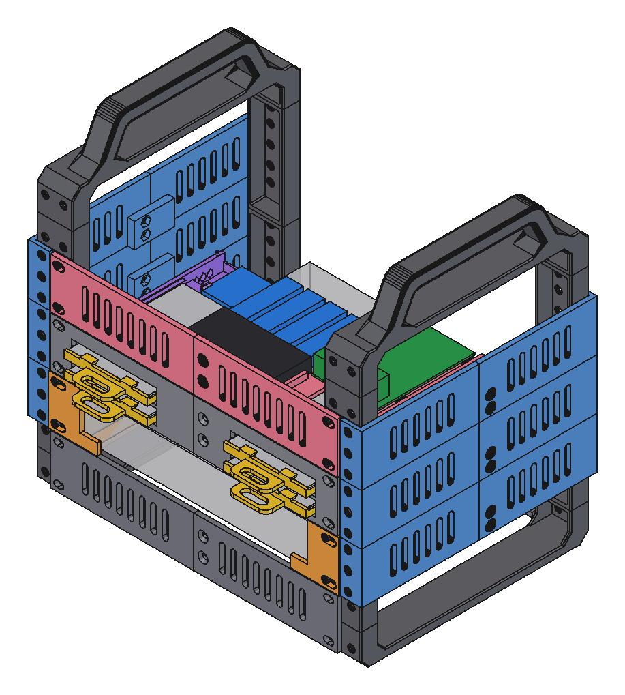
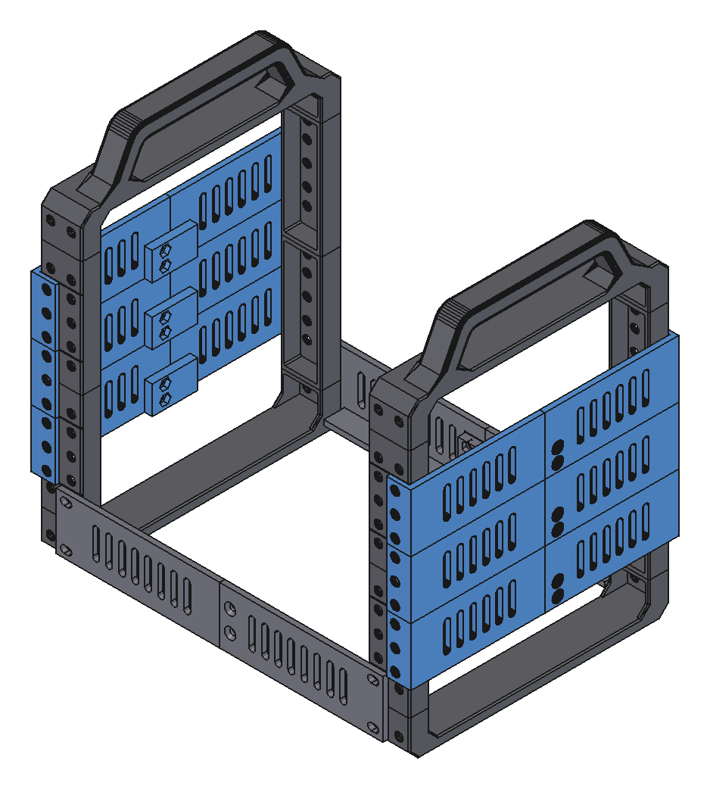
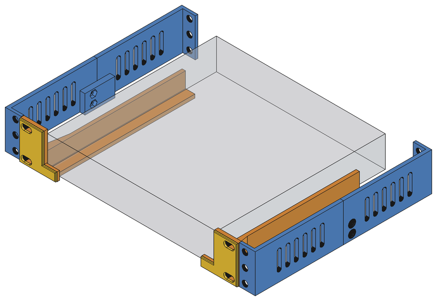
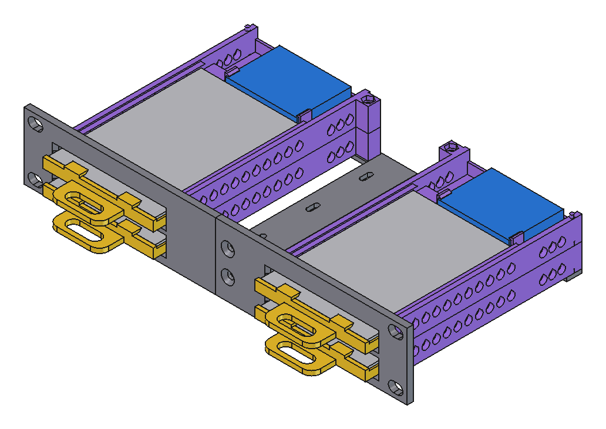
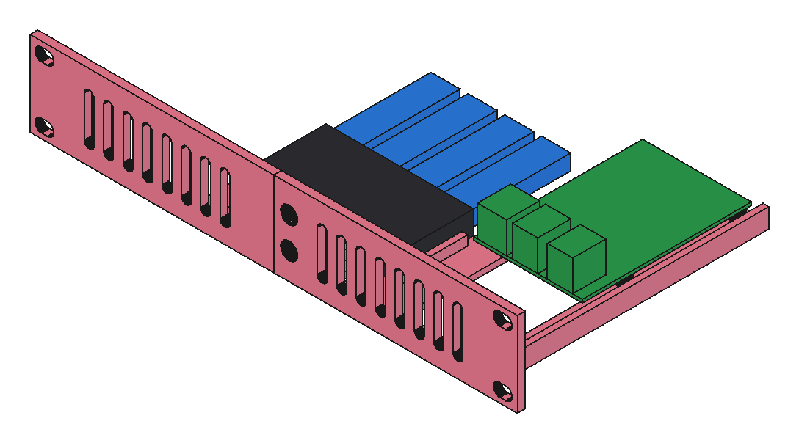

# Modular 10" Mini Rack: A1 mini edition

A remix of bwees' [Modular 10" Rack](https://www.printables.com/model/1170708-modular-1010-inch-rack). Every part fits the **Bambu Lab A1 mini** bed (180 × 180 mm).

The rack is built in layers:

1. [Base](#1-base): the frame
2. [Mac mini](#2-mac-mini): a Mac mini 2012
3. [NAS](#3-nas): 4 hot-swap 2.5" drives
4. [Control](#4-control): a Raspberry Pi and a USB hub

**Print everything in PETG, 0.20 mm Standard, no supports.**

- `ReadyToPrint/`: plates ready to print
- `stl/`: single parts
- `freecad/`: the 3D model

---

## 1. Base

| Print | How many | Time |
|---|---|---|
| `ReadyToPrint/rack-uprights-3u-x4.stl` | 2× | 4 h 07 min |
| `ReadyToPrint/rack-feet-x2-gussets-x4.3mf` | 1× | 3 h 16 min |
| `ReadyToPrint/join-plate-standing-x1.3mf` | 2× | 2 h 16 min |
| `ReadyToPrint/side-support-m6-front-back-halves.3mf` | 6× | 1 h 39 min |
| `ReadyToPrint/rack-top-handle-x1.stl` | 2× | 3 h 11 min |

**Screws:** M6 × 12 button-head screws with M6 square nuts. The join plates and side supports also need 2× M4 × 10 countersunk screws with M4 nuts each.

## 2. Mac mini

| Print | How many | Time |
|---|---|---|
| `ReadyToPrint/macmini2012-holder-left-right.3mf` | 1× | 1 h 26 min |

**Screws:** M6 × 12 button-head screws with M6 square nuts.

## 3. NAS

4 drive slots. Each 7 mm 2.5" drive slides in from the front and plugs into a SATA-USB adapter at the back. The adapter snaps into place. A clip-on handle lets you pull the drive out.

| Print | How many | Time |
|---|---|---|
| `stl/nas/nas-base-left.stl` | 1× | 1 h 55 min |
| `stl/nas/nas-base-right.stl` | 1× | 1 h 42 min |
| `stl/nas/nas-socket-left.stl` | 2× | 2 h 05 min |
| `stl/nas/nas-socket-right.stl` | 2× | 2 h 03 min |
| `ReadyToPrint/hdd-handle-landing-2.0mm-x4.stl` | 1× | 58 min |

**Screws:**
- Base: M6 × 12 button-head screws with M6 square nuts, plus 2× M4 × 10 countersunk screws with M4 nuts.
- Sockets: M3 countersunk screws with M3 nuts: M3 × 20 for one socket, M3 × 35 for two stacked.

**Test first (optional):** `stl/nas/nas-adapter-holder-test.stl` (25 min) checks that your adapter fits.

## 4. Control

Holds a Raspberry Pi 3B+ and a powered 4-port USB hub. The drive cables go up behind the hub.

| Print | How many | Time |
|---|---|---|
| `stl/control-floor/control-floor-pi-hub-left.stl` | 1× | 2 h 23 min |
| `stl/control-floor/control-floor-pi-hub-right.stl` | 1× | 3 h 08 min |

**Screws:** M6 × 12 button-head screws with M6 square nuts, 2× M4 × 10 countersunk screws with M4 nuts, and 4× M2.5 screws for the Pi.

**Power:** the hub needs its own 5 V 3–4 A supply. The Pi needs 5 V 2.5 A.

---

## Credits & license

Original design by **[bwees](https://www.printables.com/@bwees)**: [Modular 10" Rack](https://www.printables.com/model/1170708-modular-1010-inch-rack). The `bwees-*` files are his parts. Shared under **[CC BY-NC-SA 4.0](LICENSE)**.
