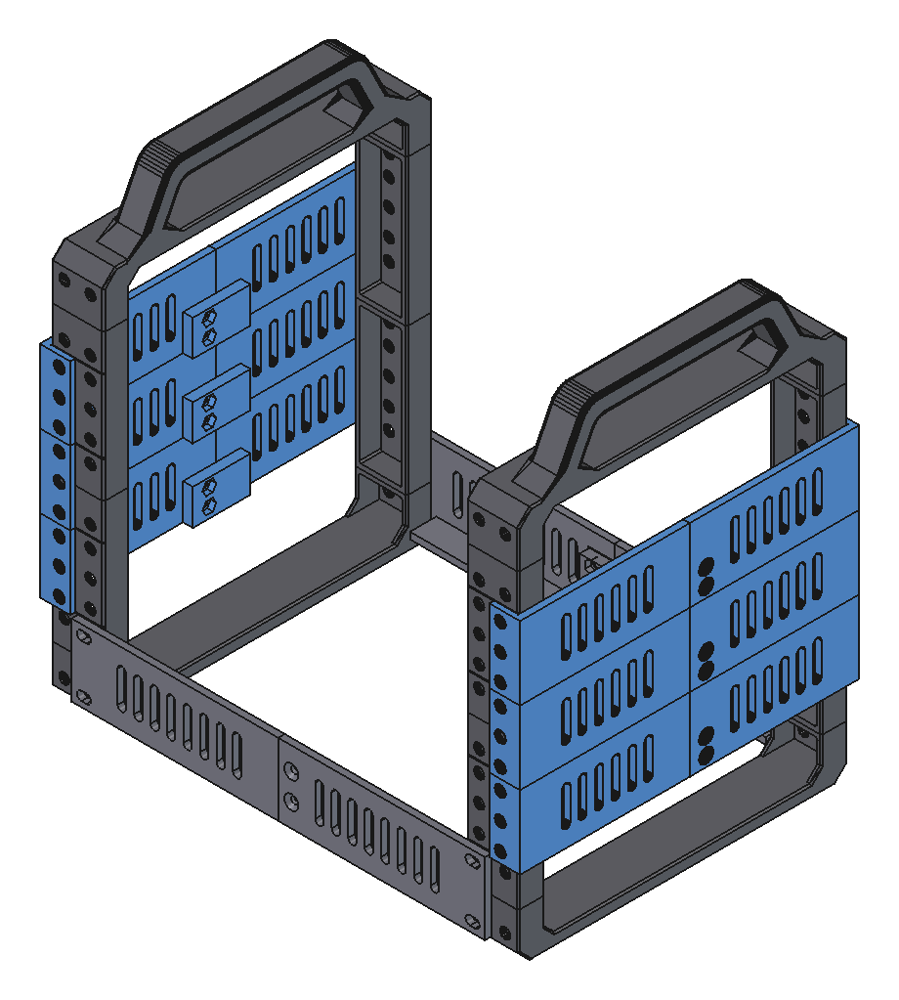

# Modular 10" Mini Rack: A1 mini edition

A remix of bwees' [Modular 10" Rack](https://www.printables.com/model/1170708-modular-1010-inch-rack). Every part fits the **Bambu Lab A1 mini** bed (180 × 180 mm).

The rack is built in layers:

1. [Shell](#1-shell): the frame
2. [Mac mini](#2-mac-mini): a Mac mini 2012
3. [NAS](#3-nas): 4 hot-swap 2.5" drives

**How to print:** open a file from `ReadyToPrint/` in Bambu Studio and print it. Each `.3mf` is one plate, already set up for the A1 mini with PETG, 0.20 mm layers and no supports. The only exception is the feet plate, which has its supports already set.

- `ReadyToPrint/`: print plates, one folder per layer
- `STL/`: single parts, one folder per layer
- `freecad/`: the 3D model

---

## 1. Shell

| Print (`ReadyToPrint/shell/`) | How many | Time |
|---|---|---|
| `shell-uprights-3u-x4.3mf` | 2× | 4 h 06 min |
| `shell-feet-x2-gussets-x4.3mf` | 1× | 3 h 16 min |
| `shell-join-plate-left-right.3mf` | 2× | 2 h 16 min |
| `shell-side-support-front-back.3mf` | 6× | 1 h 39 min |
| `shell-top-handle-x1.3mf` | 2× | 3 h 12 min |

**Screws:** M6 × 12 button-head screws with M6 square nuts. The join plates and side supports also need 2× M4 × 10 countersunk screws with M4 nuts each.

## 2. Mac mini

| Print (`ReadyToPrint/macmini/`) | How many | Time |
|---|---|---|
| `macmini-holders-left-right.3mf` | 1× | 1 h 26 min |

**Screws:** M6 × 12 button-head screws with M6 square nuts.

## 3. NAS

4 drive slots. Each 7 mm 2.5" drive slides in from the front and plugs into a SATA-USB adapter at the back. The adapter snaps into place. A clip-on handle lets you pull the drive out.

| Print (`ReadyToPrint/nas/`) | How many | Time |
|---|---|---|
| `nas-base-left.3mf` | 1× | 1 h 55 min |
| `nas-base-right.3mf` | 1× | 1 h 42 min |
| `nas-sockets-left-right.3mf` | 2× | 4 h 07 min |
| `nas-hdd-handles-x4.3mf` | 1× | 58 min |

**Screws:**
- Base: M6 × 12 button-head screws with M6 square nuts, plus 2× M4 × 10 countersunk screws with M4 nuts.
- Sockets: M3 countersunk screws with M3 nuts: M3 × 20 for one socket, M3 × 35 for two stacked.

**Test first (optional):** `nas-test-adapter-holder.3mf` (25 min) checks that your adapter fits.

---

## Credits & license

Original design by **[bwees](https://www.printables.com/@bwees)**: [Modular 10" Rack](https://www.printables.com/model/1170708-modular-1010-inch-rack). The `bwees-*` files in `STL/shell/` are his parts. Shared under **[CC BY-NC-SA 4.0](LICENSE)**.
