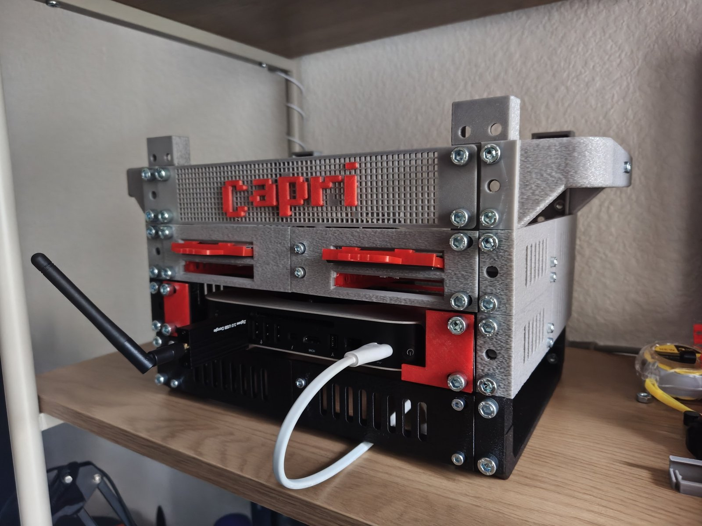
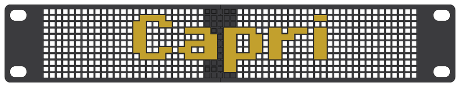

# Modular 10" Mini Rack: A1 mini edition

A 10" mini rack for a **Mac mini 2012**, a **4-drive 2.5" NAS** with a **Raspberry Pi 3B+**, and a pixel-style name plate. It is a remix of bwees' [Modular 10" Rack](https://www.printables.com/model/1170708-modular-1010-inch-rack), and every part fits the **Bambu Lab A1 mini** bed (180 × 180 mm).

## Quick start

1. Open each file from [`print/`](print) in Bambu Studio and print it the number of times shown in the tables below. Every file is one plate, already set up for the A1 mini, PETG, 0.20 mm layers and no supports. The only exception is the feet plate, which has its supports already set.
2. Buy the screws from the [shopping list](#shopping-list).
3. Build it from the bottom up: see [Assembly](#assembly).

The whole rack is **21 plates, about 47 h of printing and 0.7 kg of PETG**. The drive handles, the Mac mini covers and the cover letters look best in a second colour (red in the photo).

## What's in the repo

| Folder | What's inside |
|---|---|
| [`print/`](print) | **start here:** print plates (`.3mf`), one folder per layer |
| [`stl/`](stl) | the single parts (`.stl`), if you want to set up your own plates |
| [`cad/`](cad) | the FreeCAD model: `minirack-assembly.FCStd` (the whole rack) and `nas-layer.FCStd` |
| [`images/`](images) | the photo and the renders used here |

**File names** follow one rule: `<layer>-<part>[-<variant>]`. The layers are `shell`, `macmini`, `nas` and `cover`. Parts that are unchanged from bwees end in `-bwees`. Print plates end in `-xN` when they hold more than one copy of a part.

## The layers

From the bottom up:

| Level | Layer | What it does |
|---|---|---|
| bottom | [Shell](#1-shell) | feet, uprights, join plates |
| U2 | [Mac mini](#2-mac-mini) | two holders for a Mac mini 2012 |
| U3 | [NAS](#3-nas) | 4 hot-swap 2.5" drives, the Raspberry Pi on top |
| U4 | [Decorative cover](#4-decorative-cover) | the "Capri" name plate, with the side handles |

---

## 1. Shell

The frame: feet, uprights, the join plates at the bottom, side supports for U2 and U3, and carry handles on the sides of U4.

| Print (`print/shell/`) | How many | Time |
|---|---|---|
| `shell-upright-3u-x4.3mf` | 2× | 4 h 07 min |
| `shell-foot-x2-gusset-x4.3mf` | 1× | 3 h 16 min |
| `shell-join-plate-left-right.3mf` | 2× | 2 h 16 min |
| `shell-side-support-front-back.3mf` | 4× | 1 h 39 min |
| `shell-side-handle-front-back.3mf` | 2× | 2 h 48 min |
| `shell-top-handle.3mf` (optional, not in the photo) | 2× | 3 h 11 min |

- **Side supports and side handles** are split into a front and a back half because the full side is too long for the A1 mini. The two halves of a side support are joined with 2× M4 × 10 countersunk screws. The handle halves are joined the same way, in the middle of the grip.
- **Side handles:** they replace the side supports on the top level (U4). They print with the grip on the bed. **Mount them upside down**, so the grip is at the top. Turned over, the half that printed as the front goes to the back. Want plain sides instead? Print the side supports 6× and skip the handles.
- **Top handles (optional):** bwees' handles that go on top of the uprights. They are not on the photo. The joint between a handle and an upright is held by gussets across it (print extra from `stl/shell/shell-gusset-1x3-bwees.stl`), the same way the uprights sit on the feet.

## 2. Mac mini

| Print (`print/macmini/`) | How many | Time |
|---|---|---|
| `macmini-holder-left-right.3mf` | 1× | 1 h 26 min |
| `macmini-cover-left-right.3mf` (optional) | 1× | 19 min |

**Colour covers (optional):** two 2 mm plates for the front of the holders, in a second colour. They have the same slots as the holders, so the holder screws clamp them too. With the covers, use M6 × 16 for the 4 holder screws. If the tip of a cover's foot lifts, put a piece of double-sided tape behind it.

## 3. NAS

4 drive slots. Each 7 mm 2.5" drive slides in from the front and plugs into a SATA-USB adapter at the back. The adapter snaps into place. A clip-on handle lets you pull the drive out.

A **Raspberry Pi 3B+** sits on a frame on top of the two drive stacks. The frame also locks the two stacks together. The drive cables (13 cm) come up behind the slots and plug straight into the Pi's USB ports, and the Pi's power port stays free on the right.

| Print (`print/nas/`) | How many | Time |
|---|---|---|
| `nas-base-left.3mf` | 1× | 1 h 55 min |
| `nas-base-right.3mf` | 1× | 1 h 42 min |
| `nas-socket-left-right.3mf` | 2× | 4 h 07 min |
| `nas-hdd-handle-x4.3mf` | 1× | 58 min |
| `nas-pi-holder-screws.3mf` **or** `nas-pi-holder-pins.3mf` | 1× | 41 min |

No Pi? Print `nas-socket-bracket-x2.3mf` (18 min) instead of the Pi holder. It locks the two stacks together the same way.

- **Pi holder, screws:** the Pi is held by 4× M2.5 × 5 screws into the standoffs. They cut their own thread. M2.5 × 6 is too long.
- **Pi holder, pins:** no screws. The Pi drops onto 4 pins. To lock it, melt the pin tips flat with a soldering iron or add a drop of hot glue.
- **Handles:** the plate uses the 2.0 mm landing. If a handle sits too loose or too tight, `stl/nas/` also has 1.5 mm and 2.5 mm versions.
- **Test first (optional):** `nas-adapter-holder-test.3mf` (25 min) checks that your SATA-USB adapter fits.

## 4. Decorative cover

A 1U front plate for the top level. The whole plate is a pixel grid, and the "Capri" letters are pixel tiles in a second colour. Each letter pixel lines up with one hole, and small square plugs on the back press into the grid. No glue or screws are needed for the letters.

| Print (`print/cover/`) | How many | Colour | Time |
|---|---|---|---|
| `cover-plate.3mf` (2 plate halves + splice bar) | 1× | plate colour | 3 h 04 min |
| `cover-letters.3mf` | 1× | letter colour | 23 min |

**Fit:** the plugs are 0.05 mm smaller than the holes. If the letters are loose, add a dot of glue.

---

## Shopping list

All screws are metric. Every M6 screw goes into an M6 square nut that slides into the channel of an upright or a foot.

| Item | Size | How many | Where |
|---|---|---|---|
| Button-head screw | M6 × 12 | 52–60 | everything that screws to the uprights and feet (see below) |
| Button-head screw | M6 × 16 | 4 | Mac mini holders, only with the colour covers (they replace 4 of the M6 × 12) |
| Square nut | M6 | 52–60 | one for each M6 screw |
| Countersunk screw | M4 × 10 | 18 | the joints in the middle: join plates 4, NAS base 2, side supports 8, side handles 4 |
| Nut | M4 | 18 | one for each M4 screw |
| Countersunk screw | M3 × 40 | 4 | through the drive stacks. Use M3 × 35 if you fit neither the Pi holder nor the socket brackets |
| Nut | M3 | 4 | one for each M3 screw |
| Screw | M2.5 × 5 | 4 | the Pi, screw version of the Pi holder only |

Where the M6 screws go: gussets 8, join plates 8, the three front plates (Mac mini holders, NAS base, cover) 12, side supports 16–20, side handles 8–12. Each end of a side support or handle has 3 holes. 2 screws per end are enough (the photo uses 2), and the third hole is optional. The optional top handles need more M6 screws and gussets.

You also need: 4× SATA-to-USB adapters with a 13 cm cable, the 2.5" drives, a Raspberry Pi 3B+ and a Mac mini 2012.

## Assembly

The full model is in `cad/minirack-assembly.FCStd`. Open it in FreeCAD when you want to see how a part sits.

1. **Feet and uprights.** Stand a bottom upright on each corner of the two feet. At each corner, fix the upright to the foot with a gusset in the outer hole column and a join plate in the inner column. Join the two halves of each join plate (front and back) with 2× M4 × 10.
2. **Top uprights.** Stack the second upright on each bottom upright.
3. **U2, Mac mini.** Join each pair of side-support halves (2× M4 × 10) and screw them to the uprights on both sides. Screw the Mac mini holders to the front (with the colour covers under the screw heads if you printed them).
4. **U3, NAS.** Fit the side supports the same way. They also lock the two stacked uprights together. Screw the two base halves together (2× M4 × 10). The easiest way is to bolt the drive sockets onto the base (M3) before you screw the base to the front. Then put in the adapters, the drives and the handles.
5. **Pi.** Put the Pi holder (or the socket brackets) on the 4 inner socket screws, then the Pi.
6. **U4.** Join the two halves of each side handle (2× M4 × 10), then screw the handles to the uprights with the grip at the top. Press the splice bar and the letters into the cover, then screw the cover to the front.

## Credits & license

Original design by **[bwees](https://www.printables.com/@bwees)**: [Modular 10" Rack](https://www.printables.com/model/1170708-modular-1010-inch-rack). The `*-bwees` files in `stl/shell/` are his parts, unchanged. Shared under **[CC BY-NC-SA 4.0](LICENSE)**.
